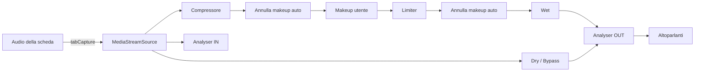

<p align="center">
  
</p>

<h1 align="center">Tab Compressor / Limiter</h1>

<p align="center">
  <b>Un vero compressore + limiter da studio, dentro ogni scheda di Chrome.</b><br>
  Basta video troppo bassi, pubblicità che urlano e film dove i dialoghi sussurrano e le esplosioni fanno tremare i vetri.
</p>

<p align="center">
  
  
  
  
  
  <a href="LICENSE"></a>
</p>

---

## Cos'è

**Tab Compressor** cattura l'audio della scheda attiva e lo fa passare in tempo reale per una catena di dinamica professionale: **compressore → makeup gain → limiter**. Tutti i parametri sono regolabili al volo, con curva di trasferimento interattiva e meter live, come in un plugin da DAW.

Funziona su qualsiasi sito che riproduce audio: YouTube, Twitch, Netflix, Spotify Web, podcast, videocall nel browser.

## Caratteristiche

- **Compressore completo** — Threshold, Ratio, Knee, Attack, Release e Makeup, con gli stessi range di un compressore hardware.
- **Limiter con ceiling** — un tetto in dB che il segnale non supera: protegge orecchie e casse dai picchi improvvisi.
- **Curva di trasferimento live** — il grafico input/output si ridisegna mentre muovi gli slider, con un punto verde che mostra *in tempo reale* dove sta lavorando il segnale.
- **Quattro meter** — IN, gain reduction del compressore, gain reduction del limiter e OUT, con peak hold e decadimento morbido.
- **Makeup "onesto"** — il `DynamicsCompressorNode` della Web Audio API aggiunge di nascosto un makeup automatico: Tab Compressor lo **misura con un render offline e lo annulla**, così il guadagno è esattamente quello che imposti tu e il ceiling resta davvero un ceiling.
- **Bypass A/B** istantaneo per confrontare il prima e il dopo.
- **Preset pronti** per gli usi più comuni.
- **Cambi di parametro senza click** — le transizioni sono smussate (`setTargetAtTime`), niente scatti udibili.
- **Gira in background** — chiudi il popup e l'elaborazione continua; il badge `ON` sull'icona ti ricorda quali schede sono attive.
- **Zero dipendenze, zero rete** — nessuna libreria, nessuna richiesta esterna, nessun dato raccolto. Solo Web Audio API.

## Preset

| Preset | Pensato per | Threshold | Ratio | Attack | Release | Makeup | Ceiling |
|---|---|---:|---:|---:|---:|---:|---:|
| **Leggero** | ascolto generico, intervento discreto | -18 dB | 2:1 | 20 ms | 250 ms | +2 dB | -1 dB |
| **Voce / Podcast** | parlato, interviste, lezioni | -28 dB | 4:1 | 5 ms | 150 ms | +7 dB | -1 dB |
| **Musica (glue)** | musica, tiene insieme il mix | -20 dB | 2.5:1 | 30 ms | 300 ms | +3 dB | -0.5 dB |
| **Notte** | film a basso volume: dialoghi su, esplosioni giù | -40 dB | 8:1 | 3 ms | 300 ms | +14 dB | -2 dB |
| **Solo limiter** | alza il volume senza comprimere, taglia solo i picchi | — | 1:1 | — | — | +6 dB | -1 dB |

Doppio clic su qualunque slider per riportarlo al valore predefinito.

## Come funziona



L'estensione è divisa in tre parti che comunicano via `chrome.runtime` messaging:

| File | Ruolo |
|---|---|
| `popup.html/js/css` | Interfaccia: slider, preset, curva su canvas, meter a ~20 fps |
| `background.js` | Service worker: crea/chiude il documento offscreen, gestisce il badge e la chiusura delle schede |
| `offscreen.html/js` | Motore audio: un `AudioContext` per scheda, il grafo dei nodi, la misura del makeup automatico |

Il documento [offscreen](https://developer.chrome.com/docs/extensions/reference/api/offscreen) è necessario perché in Manifest V3 il service worker non ha accesso a `AudioContext` né a `getUserMedia`. Viene creato solo quando serve e chiuso automaticamente quando non ci sono più schede attive.

## Installazione

1. Clona il repository:
   ```bash
   git clone https://github.com/mfabbrj/tab-compressor.git
   ```
2. Apri `chrome://extensions` e attiva la **Modalità sviluppatore** (in alto a destra).
3. Clicca **Carica estensione non pacchettizzata** e seleziona la cartella `tab-compressor`.
4. Fissa l'icona nella barra, apri una scheda con dell'audio e premi **ON**.

Funziona anche su Edge, Brave, Opera e gli altri browser basati su Chromium (versione 116 o successiva).

## Permessi

| Permesso | Perché serve |
|---|---|
| `tabCapture` | Catturare l'audio della scheda su cui premi ON (solo quella, solo su tua azione) |
| `offscreen` | Far girare l'`AudioContext` fuori dal service worker |
| `storage` | Ricordare le tue impostazioni tra una sessione e l'altra |

Nessun accesso al contenuto delle pagine, alla cronologia o alla rete.

## Limiti noti

- **Pagine non catturabili**: `chrome://`, Chrome Web Store e pagine interne del browser non possono essere catturate (limite di Chrome).
- **Una cattura per scheda**: se un'altra estensione sta già catturando la scheda, ricaricala e riprova.
- **Impostazioni globali**: i parametri sono condivisi da tutte le schede attive; modificarli in una li applica a tutte.
- **Limiter "quasi" brickwall**: è costruito su un `DynamicsCompressorNode` con ratio 20:1 (il massimo consentito dalla Web Audio API) e attack di 1 ms. È molto efficace, ma un picco istantaneo può superare il ceiling di una frazione di dB.

## Struttura

```
tab-compressor/
├── manifest.json
├── background.js      # service worker
├── offscreen.html
├── offscreen.js       # motore audio
├── popup.html
├── popup.css
├── popup.js           # UI, curva, meter
└── icons/
```

## Licenza

Distribuito con licenza [MIT](LICENSE): usalo, modificalo e ridistribuiscilo liberamente.
