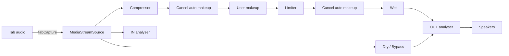

<p align="center">
  
</p>

<h1 align="center">Tab Compressor / Limiter</h1>

<p align="center">
  <b>A real studio-grade compressor + limiter, inside every Chrome tab.</b><br>
  No more quiet videos, screaming ads, or movies where the dialogue whispers and the explosions rattle the windows.
</p>

<p align="center">
  
  
  
  
  
  <a href="LICENSE"></a>
</p>

<p align="center">
  <a href="#english">English</a> · <a href="#italiano">Italiano</a>
</p>

---

<a id="english"></a>

## English

### What it is

**Tab Compressor** captures the audio of the active tab and runs it in real time through a professional dynamics chain: **compressor → makeup gain → limiter**. Every parameter can be tweaked on the fly, with an interactive transfer curve and live meters, just like a DAW plugin.

It works on any site that plays audio: YouTube, Twitch, Netflix, Spotify Web, podcasts, in-browser video calls.

### Features

- **Full compressor**: Threshold, Ratio, Knee, Attack, Release and Makeup, with the same ranges as a hardware unit.
- **Limiter with ceiling**: a dB ceiling the signal won't cross, protecting your ears and speakers from sudden peaks.
- **Live transfer curve**: the input/output graph redraws as you move the sliders, with a green dot showing *in real time* where the signal is sitting.
- **Four meters**: IN, compressor gain reduction, limiter gain reduction and OUT, with peak hold and smooth decay.
- **Honest makeup**: the Web Audio API's `DynamicsCompressorNode` silently adds automatic makeup gain. Tab Compressor **measures it with an offline render and cancels it**, so the gain is exactly what you set and the ceiling really is a ceiling.
- **Instant A/B bypass** to compare before and after.
- **Ready-made presets** for the most common uses.
- **Click-free parameter changes**: transitions are smoothed (`setTargetAtTime`), no audible zipper noise.
- **Runs in the background**: close the popup and processing keeps going. The `ON` badge on the icon shows which tabs are active.
- **Zero dependencies, zero network**: no libraries, no external requests, no data collected. Just the Web Audio API.

### Presets

| Preset | Built for | Threshold | Ratio | Attack | Release | Makeup | Ceiling |
|---|---|---:|---:|---:|---:|---:|---:|
| **Leggero** (Light) | general listening, subtle touch | -18 dB | 2:1 | 20 ms | 250 ms | +2 dB | -1 dB |
| **Voce / Podcast** (Voice) | speech, interviews, lectures | -28 dB | 4:1 | 5 ms | 150 ms | +7 dB | -1 dB |
| **Musica** (Music glue) | music, holds the mix together | -20 dB | 2.5:1 | 30 ms | 300 ms | +3 dB | -0.5 dB |
| **Notte** (Night) | movies at low volume: dialogue up, explosions down | -40 dB | 8:1 | 3 ms | 300 ms | +14 dB | -2 dB |
| **Solo limiter** (Limiter only) | louder without compressing, just catches peaks | — | 1:1 | — | — | +6 dB | -1 dB |

Double-click any slider to reset it to its default value. The UI is in Italian.

### How it works



The extension has three parts that talk through `chrome.runtime` messaging:

| File | Role |
|---|---|
| `popup.html/js/css` | UI: sliders, presets, canvas curve, meters at ~20 fps |
| `background.js` | Service worker: creates/closes the offscreen document, handles the badge and closed tabs |
| `offscreen.html/js` | Audio engine: one `AudioContext` per tab, the node graph, the auto-makeup measurement |

The [offscreen document](https://developer.chrome.com/docs/extensions/reference/api/offscreen) is needed because in Manifest V3 the service worker has no access to `AudioContext` or `getUserMedia`. It is created only when needed and closed automatically when no tabs are active.

### Installation

1. Clone the repository:
   ```bash
   git clone https://github.com/mfabbrj/tab-compressor.git
   ```
2. Open `chrome://extensions` and turn on **Developer mode** (top right).
3. Click **Load unpacked** and select the `tab-compressor` folder.
4. Pin the icon to the toolbar, open a tab with some audio and press **ON**.

It also works on Edge, Brave, Opera and other Chromium-based browsers (version 116 or later).

### Permissions

| Permission | Why |
|---|---|
| `tabCapture` | Capture the audio of the tab where you press ON (only that one, only when you ask) |
| `offscreen` | Run the `AudioContext` outside the service worker |
| `storage` | Remember your settings between sessions |

No access to page content, history or the network.

### Known limitations

- **Non-capturable pages**: `chrome://`, the Chrome Web Store and internal browser pages can't be captured (a Chrome restriction).
- **One capture per tab**: if another extension is already capturing the tab, reload it and try again.
- **Global settings**: parameters are shared by all active tabs; changing them in one applies to all.
- **"Almost" brickwall limiter**: it's built on a `DynamicsCompressorNode` with a 20:1 ratio (the maximum the Web Audio API allows) and 1 ms attack. Very effective, but an instantaneous peak can overshoot the ceiling by a fraction of a dB.

### License

Released under the [MIT](LICENSE) license: use it, modify it and redistribute it freely.

---

<a id="italiano"></a>

## Italiano

### Cos'è

**Tab Compressor** cattura l'audio della scheda attiva e lo fa passare in tempo reale per una catena di dinamica professionale: **compressore → makeup gain → limiter**. Tutti i parametri sono regolabili al volo, con curva di trasferimento interattiva e meter live, come in un plugin da DAW.

Funziona su qualsiasi sito che riproduce audio: YouTube, Twitch, Netflix, Spotify Web, podcast, videocall nel browser.

### Caratteristiche

- **Compressore completo**: Threshold, Ratio, Knee, Attack, Release e Makeup, con gli stessi range di un compressore hardware.
- **Limiter con ceiling**: un tetto in dB che il segnale non supera, per proteggere orecchie e casse dai picchi improvvisi.
- **Curva di trasferimento live**: il grafico input/output si ridisegna mentre muovi gli slider, con un punto verde che mostra *in tempo reale* dove sta lavorando il segnale.
- **Quattro meter**: IN, gain reduction del compressore, gain reduction del limiter e OUT, con peak hold e decadimento morbido.
- **Makeup "onesto"**: il `DynamicsCompressorNode` della Web Audio API aggiunge di nascosto un makeup automatico. Tab Compressor lo **misura con un render offline e lo annulla**, così il guadagno è esattamente quello che imposti tu e il ceiling resta davvero un ceiling.
- **Bypass A/B** istantaneo per confrontare il prima e il dopo.
- **Preset pronti** per gli usi più comuni.
- **Cambi di parametro senza click**: le transizioni sono smussate (`setTargetAtTime`), niente scatti udibili.
- **Gira in background**: chiudi il popup e l'elaborazione continua. Il badge `ON` sull'icona ti ricorda quali schede sono attive.
- **Zero dipendenze, zero rete**: nessuna libreria, nessuna richiesta esterna, nessun dato raccolto. Solo Web Audio API.

### Preset

| Preset | Pensato per | Threshold | Ratio | Attack | Release | Makeup | Ceiling |
|---|---|---:|---:|---:|---:|---:|---:|
| **Leggero** | ascolto generico, intervento discreto | -18 dB | 2:1 | 20 ms | 250 ms | +2 dB | -1 dB |
| **Voce / Podcast** | parlato, interviste, lezioni | -28 dB | 4:1 | 5 ms | 150 ms | +7 dB | -1 dB |
| **Musica (glue)** | musica, tiene insieme il mix | -20 dB | 2.5:1 | 30 ms | 300 ms | +3 dB | -0.5 dB |
| **Notte** | film a basso volume: dialoghi su, esplosioni giù | -40 dB | 8:1 | 3 ms | 300 ms | +14 dB | -2 dB |
| **Solo limiter** | alza il volume senza comprimere, taglia solo i picchi | — | 1:1 | — | — | +6 dB | -1 dB |

Doppio clic su qualunque slider per riportarlo al valore predefinito.

### Come funziona

La catena audio è quella del diagramma nella sezione inglese. L'estensione è divisa in tre parti che comunicano via `chrome.runtime` messaging:

| File | Ruolo |
|---|---|
| `popup.html/js/css` | Interfaccia: slider, preset, curva su canvas, meter a ~20 fps |
| `background.js` | Service worker: crea/chiude il documento offscreen, gestisce il badge e la chiusura delle schede |
| `offscreen.html/js` | Motore audio: un `AudioContext` per scheda, il grafo dei nodi, la misura del makeup automatico |

Il [documento offscreen](https://developer.chrome.com/docs/extensions/reference/api/offscreen) è necessario perché in Manifest V3 il service worker non ha accesso a `AudioContext` né a `getUserMedia`. Viene creato solo quando serve e chiuso automaticamente quando non ci sono più schede attive.

### Installazione

1. Clona il repository:
   ```bash
   git clone https://github.com/mfabbrj/tab-compressor.git
   ```
2. Apri `chrome://extensions` e attiva la **Modalità sviluppatore** (in alto a destra).
3. Clicca **Carica estensione non pacchettizzata** e seleziona la cartella `tab-compressor`.
4. Fissa l'icona nella barra, apri una scheda con dell'audio e premi **ON**.

Funziona anche su Edge, Brave, Opera e gli altri browser basati su Chromium (versione 116 o successiva).

### Permessi

| Permesso | Perché serve |
|---|---|
| `tabCapture` | Catturare l'audio della scheda su cui premi ON (solo quella, solo su tua azione) |
| `offscreen` | Far girare l'`AudioContext` fuori dal service worker |
| `storage` | Ricordare le tue impostazioni tra una sessione e l'altra |

Nessun accesso al contenuto delle pagine, alla cronologia o alla rete.

### Limiti noti

- **Pagine non catturabili**: `chrome://`, Chrome Web Store e pagine interne del browser non possono essere catturate (limite di Chrome).
- **Una cattura per scheda**: se un'altra estensione sta già catturando la scheda, ricaricala e riprova.
- **Impostazioni globali**: i parametri sono condivisi da tutte le schede attive; modificarli in una li applica a tutte.
- **Limiter "quasi" brickwall**: è costruito su un `DynamicsCompressorNode` con ratio 20:1 (il massimo consentito dalla Web Audio API) e attack di 1 ms. È molto efficace, ma un picco istantaneo può superare il ceiling di una frazione di dB.

### Licenza

Distribuito con licenza [MIT](LICENSE): usalo, modificalo e ridistribuiscilo liberamente.

---

```
tab-compressor/
├── manifest.json
├── background.js      # service worker
├── offscreen.html
├── offscreen.js       # audio engine / motore audio
├── popup.html
├── popup.css
├── popup.js           # UI, curve, meters
├── icons/
└── LICENSE
```
